# VORA Coach

App Android en Kotlin y Jetpack Compose que reproduce el diseño de VORA Coach, para el parcial domiciliario de Taller de Programación 3 (ORT Argentina, entrega del 28/10/2026). Todas las pantallas del Figma son navegables; los dos recorridos funcionales son el **catálogo de entrenamientos** (Retrofit + caché en Room) y el **registro de comidas** (Room), organizados con ViewModel e inyección de dependencias con Hilt.

- **Figma:** [Parcial-Domiciliario-7-Oct-26](https://www.figma.com/design/1nvbbfYNYmKAevuaG28J85/Parcial-Domiciliario-7-Oct-26) (archivo `1nvbbfYNYmKAevuaG28J85`, página `>UI Screens`)
- **Board de Trello:** [TP3 · Parcial VORA Coach](https://trello.com/b/fDQQV0fL/tp3-parcial-vora-coach)
- **Servidor:** mock local del docente en `http://10.0.2.2:8000/` desde el emulador ([Servidor y URL base](#servidor-y-url-base))
- **Video de demostración:** [más abajo](#video-de-demostración-ent-03) · **Comparaciones visuales:** [más abajo](#comparaciones-visuales-ent-02) · **Uso de IA:** [más abajo](#uso-de-ia-generativa-ent-04)

## Integrantes

| Integrante | GitHub |
|---|---|
| Ezequiel Matias Grynberg | [ezemg](https://github.com/ezemg) |
| Ezequiel Tamasi | [TamasiEzequiel](https://github.com/TamasiEzequiel) |
| Matias Korz | [MatiasKorz](https://github.com/MatiasKorz) |

## Cómo ejecutarlo

### Requisitos

- **Android Studio** con el SDK de **API 37** y un emulador (el de referencia mide ~390 dp de ancho, como los frames de Figma).
- **JDK:** `gradlew.bat` necesita `JAVA_HOME`. Si no está definida, apuntala al JDK que trae Android Studio (`C:\Program Files\Android\Android Studio\jbr`). El daemon de Gradle pide JDK 25 y lo descarga solo si no lo encuentra.
- **Ubicación del SDK:** Gradle la lee de `local.properties` (`sdk.dir`), que no está en el repo. Abrir el proyecto una vez en Android Studio lo crea solo; para compilar solo desde la terminal, definí `ANDROID_HOME` (en Windows suele ser `%LOCALAPPDATA%\Android\Sdk`). Sin eso, el build falla con "SDK location not found".
- **Python 3.9 o posterior** para el mock (sin dependencias; con Python 3.8 falla).
- El primer build descarga Gradle, las dependencias y quizás el JDK 25: necesita internet y tarda.

Más detalle del ambiente en [`docs/onboarding/README.md`](docs/onboarding/README.md).

### 1. Levantar el mock

El mock es el paquete `mock.zip` del material de la materia. **No está en este repo:** descargalo, descomprimilo en una carpeta propia (fuera del repo) y, desde esa carpeta:

```bash
python mock/server.py      # en Windows también: py mock\server.py
```

Escucha en `http://127.0.0.1:8000/` y se detiene con Ctrl+C. Para comprobarlo: `curl http://127.0.0.1:8000/health` responde `{"status": "ok", ...}`. En el navegador, `/docs` muestra el Swagger con el contrato. Si el puerto 8000 está ocupado, levantalo con `--port 8001` y cambiá la URL base de la app ([abajo](#servidor-y-url-base)).

### 2. Compilar y correr la app

Desde la raíz del repo:

| Shell | Compilar | Instalar en el emulador abierto |
|---|---|---|
| PowerShell | `.\gradlew.bat :app:assembleDebug` | `.\gradlew.bat :app:installDebug` |
| CMD | `gradlew.bat :app:assembleDebug` | `gradlew.bat :app:installDebug` |
| Git Bash | `./gradlew.bat :app:assembleDebug` | `./gradlew.bat :app:installDebug` |
| Linux, macOS o WSL con SDK | `./gradlew :app:assembleDebug` | `./gradlew :app:installDebug` |

También se puede usar el botón Run de Android Studio con un emulador abierto. La app arranca en SignIn: **"Sign In"** entra a Home con el perfil de demostración, sin credenciales ni Firebase.

**La demo se hace con el build debug:** solo ese build permite HTTP en claro hacia `10.0.2.2` y trae el receptor para cambiar los escenarios del mock con `adb` ([Cómo provocar los escenarios](#cómo-provocar-los-escenarios-en-la-demo)).

### 3. Tests unitarios

```bash
.\gradlew.bat :app:testDebugUnitTest
```

Cubren mappers, repositorios, validación del formulario de comidas y los ViewModels (`app/src/test`).

### Servidor y URL base

- **Servidor usado:** el mock local del docente. Desde el emulador, la app lo llama en `http://10.0.2.2:8000/` (la IP del host vista desde el emulador).
- **Dónde se configura:** el recurso `base_url` de [`app/src/main/res/values/strings.xml`](app/src/main/res/values/strings.xml); lo lee `di/RetrofitModule.kt`. La URL tiene que terminar en `/`.
- **HTTP en claro solo en debug y solo hacia `10.0.2.2`** ([`app/src/debug/res/xml/network_security_config.xml`](app/src/debug/res/xml/network_security_config.xml)). Si se cambia a otro host por HTTP (por ejemplo la IP de la PC para un teléfono por Wi-Fi), hay que agregar ese dominio ahí; una URL `https://` no necesita cambios.
- **Servidor publicado:** `https://tp3.martinrivas.ar/` respondió 200 el 26/10, pero no se usa: la demo necesita los escenarios de `X-Mock-Scenario` y poder detener el servidor (paso 4), y eso se hace con el mock local.

## Versiones utilizadas

Tomadas de [`gradle/libs.versions.toml`](gradle/libs.versions.toml), [`gradle/wrapper/gradle-wrapper.properties`](gradle/wrapper/gradle-wrapper.properties), [`gradle/gradle-daemon-jvm.properties`](gradle/gradle-daemon-jvm.properties) y `app/build.gradle.kts`.

| Componente | Versión |
|---|---|
| Android Gradle Plugin | 9.3.3 |
| Gradle (wrapper) | 9.5.0 |
| JDK del daemon de Gradle | 25 |
| Kotlin | 2.2.10 |
| KSP | 2.3.10 |
| Bytecode Java | 17 |
| `compileSdk` / `targetSdk` / `minSdk` | 37 / 37 / 26 |
| Compose BOM | 2026.02.01 |
| Navigation Compose | 2.9.7 |
| Lifecycle (runtime) / ViewModel Compose | 2.11.0 / 2.10.0 |
| Hilt / `hilt-navigation-compose` | 2.60.1 / 1.2.0 |
| Room | 2.8.5 |
| Retrofit + Gson converter | 3.0.0 |
| OkHttp + logging interceptor | 4.12.0 |
| Coroutines | 1.10.2 |
| Firebase BoM (`firebase-auth` y `firebase-firestore`, EXT-01 y EXT-02) | 34.19.0 |
| Plugin Google Services (solo se aplica si existe `app/google-services.json`) | 4.5.0 |
| Python (mock) | 3.9 o posterior |

## Estado de cada funcionalidad

### Núcleo obligatorio

| Requisito | Estado | Dónde se ve | Implementación |
|---|---|---|---|
| RF01 · Catálogo y detalle desde el mock | Funcional | Workout / 02 — Weekly Plan (sección "Workout catalog") → Workout / 03 — Workout Details → Workout / 06 — Exercise Details | `GET /v1/workouts` y `GET /v1/workouts/{workoutId}` con Retrofit (`WorkoutApi`, DTOs en `data/remote/dto`) |
| RF02 · Caché en Room y uso sin conexión | Funcional | Weekly Plan y Workout Details con el servidor detenido | `WorkoutRepository` guarda catálogo y detalles en Room; la UI lee de Room y la red solo refresca |
| RF03 · Registro manual de comidas | Funcional | Nutrition / 03 → "Log Manually" → Nutrition / 07 (`food_confirmation/manual`) | Formulario con validación (`MealFormValidation`), guardado en Room |
| RF04 · Listado por fecha, total diario y eliminación | Funcional | Nutrition / 01, 02 y 08 | `MealDao` / `MealRepository`; eliminación con diálogo de confirmación en Meal Details |
| RF05 · Estados de carga, vacío y error con reintento | Funcional | Catálogo y detalle | `UiError` y `VoraStateViews`; escenarios del mock en [la sección de RF05](#estados-de-las-consultas-remotas-y-escenarios-del-mock-rf05) |
| RF06 · Capas (DTO, Entity, repositorio, ViewModel, UI) | Funcional | — | [`docs/defensa/CAPAS-Y-ESTADO.md`](docs/defensa/CAPAS-Y-ESTADO.md) |
| RF07 · ViewModel con estado observable y rotación | Funcional | Todas las pantallas con ViewModel | `StateFlow` expuesto por cada ViewModel ([`CAPAS-Y-ESTADO.md`](docs/defensa/CAPAS-Y-ESTADO.md)) |
| RF08 · Hilt e inyección por constructor | Funcional | — | Módulos en `di/`; [`docs/defensa/HILT.md`](docs/defensa/HILT.md) |

### Funciones simuladas

Lo que la consigna permite simular está documentado fila por fila en la columna "Qué se simula" del [inventario](#inventario-de-pantallas). En resumen:

- **Acceso (1.1, 1.2):** sin `app/google-services.json`, acceso y perfil de demostración, sin endpoints de login; con Firebase configurado, registro, inicio y cierre de sesión reales ([EXT-01](#extras-con-firebase)).
- **Home, Progress y Profile (2.x, 6.x, 7.x):** datos de ejemplo del Figma; los ajustes de Profile se guardan en memoria durante la sesión, y el perfil en Firestore si Firebase está configurado (EXT-02).
- **Coach (3.1-3.6):** estados y conversación simulados, sin micrófono, audio ni servicios del coach.
- **Entrenamiento activo (4.4-4.7):** series, cronómetro y descanso simulados (SPEC p.3).
- **Nutrition por voz y foto (5.4-5.6, 5.7 `estimate`):** transcripción, análisis y estimación fijos del Figma, sin cámara, micrófono ni `POST /v1/nutrition/analyses`; lo que se confirma sí se guarda en Room.
- Los controles sin destino en el diseño informan "modo demostración" en lugar de quedar muertos (NAV03).

### Extras

| Extra | Estado |
|---|---|
| EXT-01 · Firebase Authentication | Hecho (#56). Se activa con `app/google-services.json`; sin él, acceso de demostración |
| EXT-02 · Perfil en Firestore | Hecho (#58). Requiere EXT-01 configurado; sin Firebase, perfil de demostración en memoria |
| EXT-03 · Reglas de Firestore | Hecho (#57). `firestore.rules` con tests sobre el emulador de Firestore |
| EXT-04 · Coach por Retrofit con historial en Room | No realizado |
| EXT-05 · Búsqueda de alimentos y cálculo nutricional | No realizado ("Search" informa modo demostración) |
| EXT-06 · Seguimiento de series | No realizado (simulado) |
| EXT-07 · Práctica aislada de Dagger puro | No realizado |

Las instrucciones y reglas de acceso de Firebase están en [Extras con Firebase](#extras-con-firebase).

### Decisiones tomadas por el equipo

El Figma y la consigna no las definen (las preguntas están en la tarjeta REF-05 del board). Se documentan para que no se lean como errores:

- **Catálogo (RF01):** no hay frame "Catálogo"; se muestra como sección de Workout / 02 — Weekly Plan, sin pantallas nuevas.
- **Caché frente al escenario `empty`:** una respuesta vacía muestra el estado vacío pero no borra Room ([política de caché](#estados-de-las-consultas-remotas-y-escenarios-del-mock-rf05)).
- **Escenarios en la demo:** se activan en vivo con `adb` desde el build debug ([cómo](#cómo-provocar-los-escenarios-en-la-demo)).
- **RF03 y eliminación de RF04:** el formulario reutiliza la estética de Nutrition / 07 y el borrado está en Nutrition / 08 con un diálogo de confirmación.

## Inventario de pantallas

El inventario toma los nombres reales de los 37 frames de Figma (SPEC p.1, PPTX s.4) y es la referencia de cobertura. Se actualiza en el mismo PR que cambia el estado de una pantalla.

- **Destino en la app:** ruta de navegación definida en `ui/navigation/AppDestination.kt`.
- **Estado:** `funcional` (usa datos reales del núcleo) o `demostración` (navegación y datos de ejemplo, sin servicio real).
- **Maqueta:** `Provisoria` es la pantalla de NAV-01 (nombre del frame y botones de recorrido); `Hecha` es el frame maquetado según Figma.
- Los estados del coach (Voice) pueden representarse dentro de una misma pantalla (SPEC p.8); hoy cada estado tiene su propio destino.
- Las funciones simuladas no usan micrófono ni cámara ni servicios reales (NAV05).

| Cód. | Frame de Figma | Destino en la app | Se llega desde | Estado | Maqueta | Qué se simula |
|---|---|---|---|---|---|---|
| 1.1 | Login - 01 — SignIn | `sign_in` | Inicio de la app | demostración | Hecha (validación visual pendiente) | Acceso de demostración sin Firebase; los controles opcionales (contraseña olvidada, proveedores, biometría) informan modo demostración |
| 1.2 | Login - 02 — SignUp | `sign_up` | SignIn ("Sign up here") | funcional con Firebase / demostración sin él (EXT-01) | Hecha (validación visual pendiente) | Con `google-services.json`, "Sign Up" crea la cuenta (Full Name como nombre visible) y abre Home; sin él, aviso de registro de demostración sin crear cuenta. Regreso a SignIn |
| 2.1 | Home / 01 — Dashboard | `home` | SignIn; pestaña Home | demostración | Hecha | Datos de ejemplo |
| 2.2 | Home / 02 — Notifications | `notifications` | Home | demostración | Hecha | Notificaciones de ejemplo |
| 3.1 | Voice / 01 — Idle | `voice_idle` | Home ("Start voice session") | demostración | Hecha | Estado del coach simulado; sin micrófono; los chips y "LAST CONVERSATION" llevan a destinos de ejemplo |
| 3.2 | Voice / 02 — Listening | `voice_listening` | Voice / 01 ("TAP TO TALK") | demostración / simulado | Hecha | Transcripción fija del Figma; sin micrófono real; micrófono activo abre Processing; Cancel y Atrás vuelven a Idle. [Recursos y navegación](docs/design/PAN-3.2-recursos.md) |
| 3.3 | Voice / 03 — Processing | `voice_processing` | Voice / 02 | demostración / simulado | UI hecha (validación manual pendiente) | Transcripción fija; sin consultas a servicios; avance simulado a Speaking tras 3 s activos; Cancel vuelve a Idle y Atrás a Listening. [Recursos y navegación](docs/design/PAN-3.3-recursos.md) |
| 3.4 | Voice / 04 — Speaking | `voice_speaking` | Voice / 03 | demostración / simulado | UI hecha (validación manual pendiente) | Respuesta fija; barra y controles de reproducción estáticos; sin audio real. Interrupt vuelve a Listening; chevron y Atrás a Idle. [Recursos y navegación](docs/design/PAN-3.4-recursos.md) |
| 3.5 | Voice / 05 — Conversation | `voice_conversation` | Voice / 01 (Type instead, LAST CONVERSATION y sugerencias) | demostración / simulado | UI hecha (validación manual pendiente) | Hilo inicial fijo del Figma; mensajes nuevos locales, sin historial persistido ni servicios del coach. Micrófono y audio simulados; + informa modo demostración. [Recursos y navegación](docs/design/PAN-3.5-recursos.md) |
| 3.6 | Voice / 06 — Error | `voice_error` | Mantener presionado el micrófono activo de Voice / 02 — Listening | demostración / simulado | UI hecha (validación manual pendiente) | Error y permisos simulados; Allow Access solo muestra un aviso. Try again vuelve a Listening; Type instead a Conversation; Not Now y Atrás a Idle. El toque normal del micrófono sigue hacia Processing. [Recursos y navegación](docs/design/PAN-3.6-recursos.md) |
| 4.1 | Workout / 01 — Dashboard | `workout` | Pestaña Workout | demostración | Hecha (validación visual pendiente) | Datos del Figma; catálogo en Weekly Plan según NUC-01 (confirmación docente en REF-05); "Details" de la tarjeta "Upper Body Strength" abre el entrenamiento real `w02` del mock; "Start Workout" sigue con id de demostración |
| 4.2 | Workout / 02 — Weekly Plan | `weekly_plan` | Workout / 01 | mixta: plan de demostración y catálogo funcional | Integrada (validación manual pendiente) | Conserva PAN-4.2; las tarjetas del plan de demostración abren entrenamientos reales del mock (Upper Body → `w02`, Active Recovery → `w01`, Lower Body → `w03`); catálogo GET /v1/workouts leído desde Room (NUC-01), con IDs reales hacia Details; carga, vacío y error con reintento (NUC-03) |
| 4.3 | Workout / 03 — Workout Details | `workout_details/{workoutId}` | Workout / 01 y 02 | funcional | Hecha (validación manual pendiente) | Nombre, nivel, duración y ejercicios de GET /v1/workouts/{workoutId} guardados en Room (NUC-02): se muestra lo de Room y se refresca al abrir; sin servidor, un detalle ya visto sale de Room con un aviso y "Retry", y uno nunca descargado muestra el error con "Retry" (NUC-03). Carga mientras dura la consulta; un id inexistente (404) muestra "Workout not found" sin reintento. "VORA COACH NOTE", "Edit workout" y el menú siguen de demostración; desde Workout / 01 abre `w02` |
| 4.4 | Workout / 04 — Pre Workout | `pre_workout/{workoutId}` | Workout / 01 y 03 | demostración | Hecha (validación manual pendiente) | Preparación con textos del Figma; conserva workoutId hacia Active Workout; recomendación y micrófono con avisos; sin historial real |
| 4.5 | Workout / 05 — Active Workout | `active_workout/{workoutId}` | Workout / 04 | demostración | Hecha (validación manual pendiente) | Series, carga y descanso simulados en Compose; sin cronómetro real ni persistencia; Finish Workout abre el destino existente PAN-4.7 |
| 4.6 | Workout / 06 — Exercise Details | `exercise_details/{workoutId}/{exerciseId}` | Workout / 03 | funcional | UI hecha (validación manual pendiente) | Nombre, grupo muscular, instrucciones ("Performance Steps") y tip ("PRO FORM CUES") del ejercicio guardado en Room (NUC-02); la ruta lleva los dos ids porque los ids de ejercicio se repiten entre entrenamientos. La imagen original de Figma y "Ask Vora" siguen de demostración |
| 4.7 | Workout / 07 — Workout Complete | `workout_complete` | Workout / 05 | demostración | UI hecha (validación manual pendiente) | Métricas Figma fijas y valoración local no persistida; Done/Atrás vuelven a Dashboard y limpian el flujo terminado |
| 5.1 | Nutrition / 01 — Dashboard | `nutrition` | Pestaña Nutrition | funcional | UI hecha (validación visual pendiente) | Calorías y macros consumidas y comidas de hoy desde Room (una fila por comida; tipo vacío con "+ Add"); objetivos (2,100 kcal, 140/220/65 g), porcentaje sobre esos objetivos y consejo son de ejemplo del Figma; calendario → DatePicker → 5.2 en esa fecha; "View History" → 5.2; fila → 5.8; "+ Add" → 5.3; "Voice" → 5.4 y "Photo" → 5.6 sin pedir permisos; "Search" informa modo demostración (EXT-05) |
| 5.2 | Nutrition / 02 — Today's Meals | `todays_meals` | Nutrition / 01 | funcional | Hecha | Comidas de la fecha desde Room agrupadas por tipo, total del día, flechas y DatePicker para cambiar la fecha |
| 5.3 | Nutrition / 03 — Add Food | `add_food` | Nutrition / 01 y 02 | funcional | UI hecha (validación visual pendiente) | Voz y foto llevan a 5.4 y 5.6 sin pedir permisos; "Search Database" informa modo demostración (búsqueda: EXT-05); "Log Manually" abre el registro manual de RF03 en 5.7 (`food_confirmation/manual`) |
| 5.4 | Nutrition / 04 — Voice Food Logging | `voice_food_logging` | Nutrition / 03 ("Start Voice Logging") | demostración | Hecha | Escucha simulada: no usa micrófono ni pide permisos (NAV05); transcripción de ejemplo fija del Figma; "Done Speaking" abre el análisis (5.5); "Type instead" abre el registro manual (5.7 `manual`); la X y atrás vuelven al origen |
| 5.5 | Nutrition / 05 — Food Analysis | `food_analysis` | Nutrition / 04 | demostración | UI hecha (validación visual pendiente) | Análisis simulado, sin IA ni `POST /v1/nutrition/analyses`: entrada capturada fija del Figma y 3 pasos que avanzan solos (~3 s); al terminar abre 5.7 en modo `estimate` sin guardar nada y sale de la pila; "Cancel analysis", la X y atrás vuelven a 5.4 sin guardar |
| 5.6 | Nutrition / 06 — Photo Analysis | `photo_analysis` | Nutrition / 03 ("Snap a Photo") | demostración | UI hecha (validación visual pendiente) | Análisis de foto simulado: foto y estimación de ejemplo del Figma (520 kcal), sin cámara ni permisos; "Review & Add" abre la revisión en 5.7 (`food_confirmation/estimate`); "Retake Photo" informa modo demostración |
| 5.7 | Nutrition / 07 — Food Confirmation | `food_confirmation/{mode}` | Nutrition / 03 ("Log Manually"), 05 y 06 | funcional | UI hecha (validación visual pendiente) | `manual`: formulario de RF03 (nombre, fecha sin futuras, tipo, calorías y macros) con validación, guarda en Room y abre el listado en la fecha de la comida; `estimate`: estimación fija del Figma (3 ingredientes, 520 kcal), "Add to Lunch" la guarda en Room para hoy; `-`, `+`, "Remove", "+ Add Ingredient" y "Save without logging" informan modo demostración |
| 5.8 | Nutrition / 08 — Meal Details | `meal_details/{mealId}` | Nutrition / 01 y 02 | funcional (Room) | Hecha | Tipo, fecha, calorías y macros de la comida guardada; eliminar con confirmación; anillo y consejo de ejemplo; Edit/Duplicate en modo demostración |
| 6.1 | Progress / 01 — Today's Overview | `todays_overview` | Home / 01 | demostración | Hecha | Datos de ejemplo |
| 6.2 | Progress / 02 — Dashboard | `progress` | Pestaña Progress | demostración | Hecha | Datos de ejemplo |
| 6.3 | Progress / 03 — Workout Progress | `workout_progress` | Progress / 02 | demostración | Hecha | Datos de ejemplo |
| 6.4 | Progress / 04 — Nutrition Progress | `nutrition_progress` | Progress / 02 | demostración | Hecha | Datos de ejemplo |
| 6.5 | Progress / 05 — Health Trends | `health_trends` | Progress / 02 | demostración | Hecha | Datos de ejemplo |
| 6.6 | Progress / 06 — Weekly Review | `weekly_review` | Progress / 02 | demostración | Hecha | Datos de ejemplo; "Get dinner ideas" informa modo demostración |
| 7.1 | Profile / 01 — Dashboard | `profile` | Pestaña Profile | mixta: nombre del perfil (Firestore con sesión, EXT-02) y resto de ejemplo | Hecha | El nombre sale del perfil guardado; snapshot, personalización y filas son datos de ejemplo |
| 7.2 | Profile / 02 — Edit Profile | `edit_profile` | Profile / 01 ("Edit profile") | funcional con sesión de Firebase / demostración sin ella (EXT-02) | Hecha | Con sesión, los seis campos se guardan en Firestore (`users/{uid}`) y se recuperan al reabrir; sin sesión, edición local durante la sesión. "Change photo" informa modo demostración sin cámara |
| 7.3 | Profile / 03 — Goals & Preferences | `goals_preferences` | Profile / 01 ("Your Goals") | demostración (datos locales) | Hecha | Selección local de objetivos (varios), frecuencia y tipo de entrenamiento; "Balanced" fija; lo guardado se mantiene durante la sesión y volver sin guardar lo descarta |
| 7.4 | Profile / 04 — Nutrition Preferences | `nutrition_preferences` | Profile / 01 ("Your Preferences") | demostración (datos locales) | Hecha | Selección local de tipo de alimentación (una), alimentos preferidos y prioridades (varios); los ingredientes a evitar se agregan con el campo y se quitan tocando el chip; "Meal Preferences" informa modo demostración; lo guardado se mantiene durante la sesión y volver sin guardar lo descarta |
| 7.5 | Profile / 05 — Voice & AI Settings | `voice_ai_settings` | Profile / 01 ("Review preferences") | demostración (datos locales) | Hecha | Estilo de coaching, estilo de respuesta y cinco interruptores que se mantienen durante la sesión; "Preview" informa modo demostración sin audio ni micrófono; "Privacy & permissions" abre Settings |
| 7.6 | Profile / 06 — Settings | `settings` | Profile / 01 (engranaje, "Connected Data", "Account") | demostración (datos locales) | Hecha | Notifications on/off se mantiene durante la sesión; Units, Appearance y el resto de las opciones informan modo demostración; "Alex Morgan" abre Edit Profile; "Log out" cierra la sesión de Firebase (si hay), vuelve a SignIn y vacía la pila |

## Estados de las consultas remotas y escenarios del mock (RF05)

El catálogo de entrenamientos (sección "Workout catalog" de Workout / 02 — Weekly Plan) y Workout / 03 — Workout Details muestran sus estados dentro del mismo frame, sin pantallas nuevas.

**Catálogo** (`GET /v1/workouts`):

| Estado | Cuándo | Qué se ve |
|---|---|---|
| Carga | mientras dura `GET /v1/workouts` | indicador "Loading workouts…"; si ya hay catálogo guardado, el indicador aparece encima de la lista |
| Contenido | la consulta trae entrenamientos | la lista del catálogo |
| Vacío | el servidor responde una lista vacía | "No workouts yet" |
| Error con reintento | 503, JSON inválido, timeout o servidor detenido | si no hay catálogo guardado, un error con el botón "Retry"; si lo hay, la lista guardada con un aviso y "Retry" |

**Detalle** (`GET /v1/workouts/{workoutId}`):

| Estado | Cuándo | Qué se ve |
|---|---|---|
| Carga | mientras dura la consulta | indicador "Loading workout…"; si el detalle ya está guardado, aparece encima del contenido |
| Contenido | la consulta trae el entrenamiento, o ya estaba en Room | nombre, nivel, duración y ejercicios |
| Vacío | no aplica: `empty` solo vacía listas, el detalle responde normal | — |
| Error con reintento | 503, JSON inválido, timeout o servidor detenido | si el detalle no está guardado, "Couldn't load this workout" con "Retry"; si lo está, el detalle guardado con un aviso y "Retry" |
| No encontrado | el servidor responde 404 (id inexistente) | "Workout not found", sin reintento porque repetir la consulta no lo cambia |

**Política de caché:** el catálogo y los detalles viven en Room y ninguna respuesta los borra. Una respuesta vacía muestra el estado vacío pero no vacía la caché, así que si después se detiene el servidor vuelve a verse el catálogo guardado junto con el error. Un error nunca toca Room: el catálogo, los detalles guardados y las comidas registradas siguen disponibles.

### Cómo provocar los escenarios en la demo

El mock solo cambia de escenario con los headers `X-Mock-Scenario` y `X-Mock-Delay-Ms`. En los builds **debug** la app los agrega desde un interceptor de OkHttp, y se cambian en vivo desde una terminal con `adb` (incluido en el SDK de Android, en `platform-tools`), sin recompilar. Los builds release no envían esos headers.

```bash
# Escenario: empty, error o malformed. delay en milisegundos (0 a 10000)
adb shell am broadcast -n com.example.examentp3/.debug.MockScenarioReceiver --es scenario error
adb shell am broadcast -n com.example.examentp3/.debug.MockScenarioReceiver --es scenario empty
adb shell am broadcast -n com.example.examentp3/.debug.MockScenarioReceiver --es scenario malformed
adb shell am broadcast -n com.example.examentp3/.debug.MockScenarioReceiver --ei delay 3000
# Volver al escenario normal
adb shell am broadcast -n com.example.examentp3/.debug.MockScenarioReceiver
```

Después de cambiar el escenario, tocá "Retry" o volvé a abrir Weekly Plan o el detalle. El escenario se mantiene hasta que se cambia o se cierra la app. Para el paso 4 (sin conexión), detené el mock con Ctrl+C y levantalo de nuevo antes de tocar "Retry".

## Comparaciones visuales (ENT-02)

Cinco pantallas comparadas contra su frame de Figma. Las capturas de la app se tomaron el 27/10 en el emulador Pixel 5 (1080 × 2340 px, 440 dpi ≈ **393 dp** de ancho, como los frames de 390 dp), con datos cargados por la propia app (formulario manual, análisis de foto y catálogo del mock) y la barra de estado en modo demo (9:41). Las imágenes están en [`docs/comparaciones/`](docs/comparaciones/).

| Pantalla | Figma | App (~393 dp) | Diferencias |
|---|---|---|---|
| 4.2 · Workout / 02 — Weekly Plan | 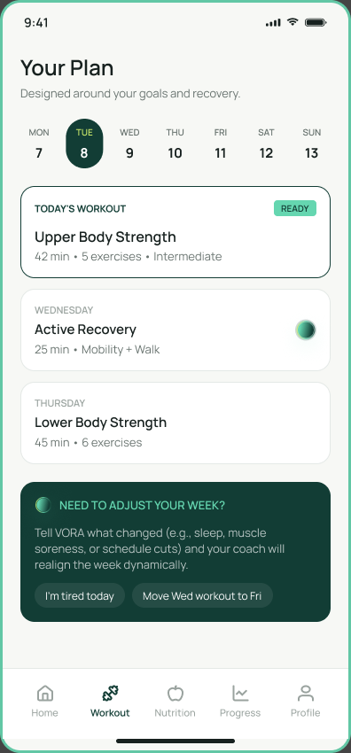 | 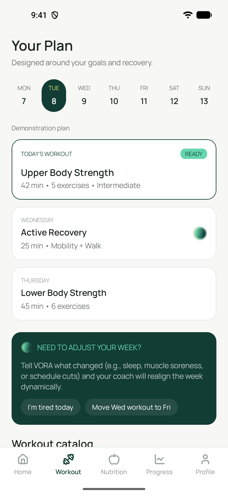 | Igual al frame. La app agrega la etiqueta "Demonstration plan" y, más abajo, la sección "Workout catalog" con el catálogo remoto (RF01). |
| 4.3 · Workout / 03 — Workout Details | 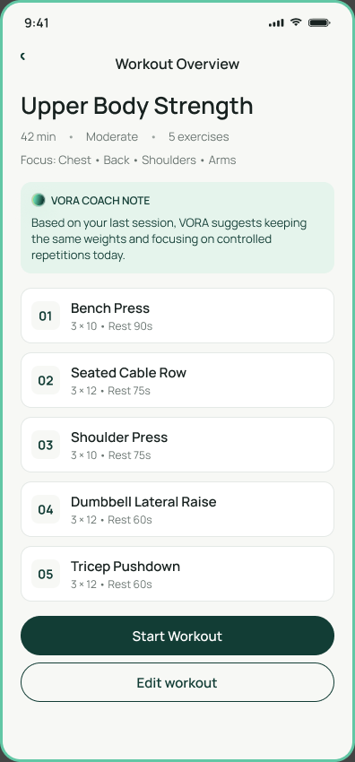 | 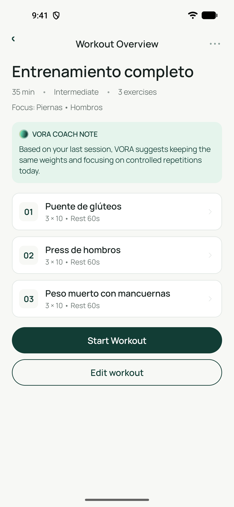 | Misma estructura; los datos son los del mock por Retrofit (`GET /v1/workouts/w02`: "Entrenamiento completo", 3 ejercicios), no los del ejemplo del Figma. |
| 5.1 · Nutrition / 01 — Dashboard | 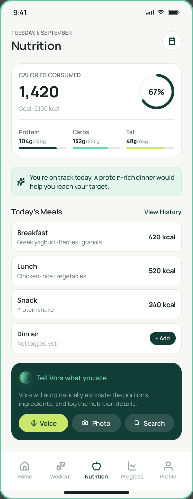 | 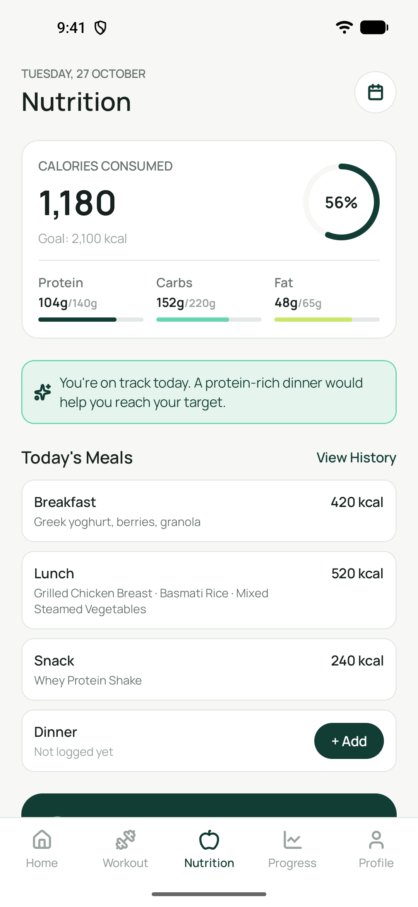 | Totales y comidas leídos de Room. El Figma dice 1,420 kcal pero sus filas suman 1,180 (inconsistencia del diseño); la app muestra la suma real. La fecha es la de hoy. |
| 5.2 · Nutrition / 02 — Today's Meals | 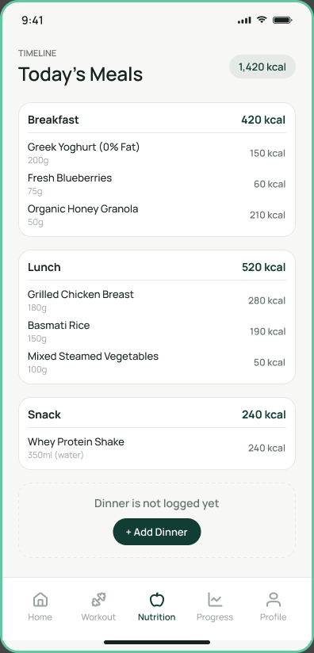 | 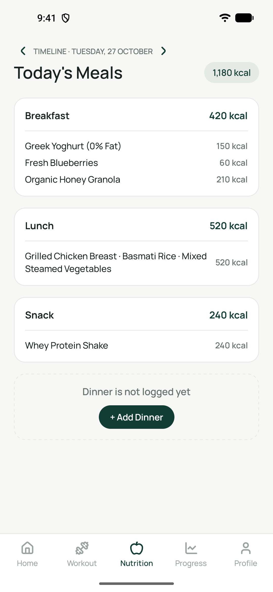 | Comidas leídas de Room. Se agregan las flechas ‹ › y el selector de fecha; las filas no muestran gramos (RF03 no los pide). |
| 5.8 · Nutrition / 08 — Meal Details | 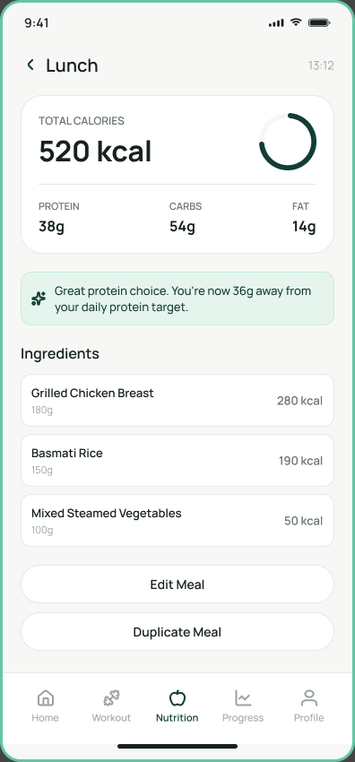 | 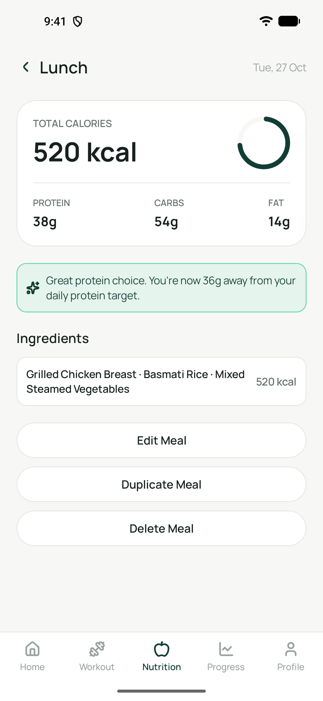 | Comida guardada desde el análisis simulado. Se muestra la fecha en lugar de la hora (Room no la guarda) y se agrega "Delete Meal" (RF04). |

**Otro tamaño de emulador (UI03):** la misma pantalla 5.1 con 360 dp de ancho (Pixel 5 con densidad 480). El contenido se acomoda sin cortes y lo que no entra se desplaza.

| 5.1 en ~393 dp | 5.1 en 360 dp |
|---|---|
|  | 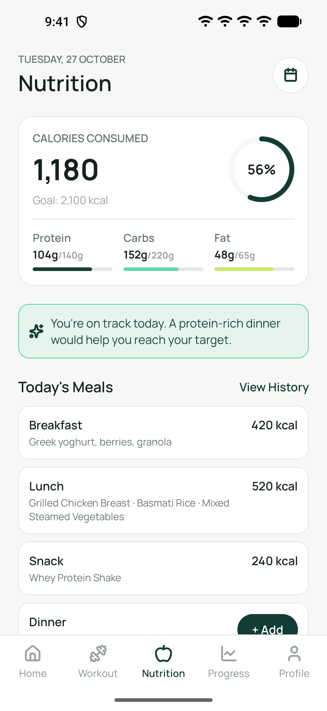 |

## Video de demostración (ENT-03)

Link al drive: https://drive.google.com/file/d/1SupBhIzXsO7t9ZcLfsVhp4v4UzurX1eQ/view?usp=sharing

El video sigue el recorrido mínimo de la demo final (PPTX s.15):

1. **Recorrido:** abrir la app y recorrer las pantallas del inventario, mostrando el regreso y la navegación inferior.
2. **Retrofit:** consultar el catálogo remoto y abrir dos entrenamientos distintos con sus detalles.
3. **Room:** registrar una comida, cerrar y abrir la app, comprobar el registro y eliminarlo, mostrando cómo cambia el total.
4. **Sin conexión:** detener el servidor y abrir un detalle ya descargado desde Room; probar error, lista vacía y reintento ([escenarios](#cómo-provocar-los-escenarios-en-la-demo)).
5. **Código:** mostrar los commits de cada integrante y explicar ViewModel, repositorios e inyección (y Firebase).

## Uso de IA generativa (ENT-04)

El equipo usó agentes de IA generativa en el desarrollo. Cada PR declara en su sección "Uso de IA" la herramienta y para qué se usó; esta tabla lo resume. Las tarjetas del board de Trello (descripción, criterios de aceptación y link al frame de Figma) se usaron como especificación para los agentes, junto con [`AGENTS.md`](AGENTS.md) y la skill del equipo `tp3-guidelines` (convenciones de arquitectura, Compose, Hilt, Retrofit y Room).

| Herramienta | Para qué se usó | Tarjetas / PRs | Cómo se revisó |
|---|---|---|---|
| Claude (chat web) | Generar el tema, los componentes compartidos y la navegación entre áreas a partir de la tarjeta y capturas del Figma; armar la tabla del inventario | BASE-01, BASE-02, NAV-01, NAV-02 (#2-#7) | El autor revisó y adaptó el código, compiló, lo comparó con el Figma en las previews y el emulador, y contrastó el inventario con `AppDestination.kt` |
| Claude Code (con subagentes y el MCP de Figma) | Planificar cada tarjeta a partir del Figma, la consigna y las guías; traducir frames a Compose y los íconos SVG a VectorDrawable; escribir la capa de datos (Retrofit, DTO, Room, repositorios), ViewModels, Hilt y tests unitarios; diagnosticar errores de compilación e integración; actualizar el README y la documentación para la defensa | DAT-01, DAT-02, DAT-03, NUC-01 a NUC-06, NAV-01 (integración), PAN-2.1, 2.2, 3.1, 5.1-5.8, 6.1-6.6, 7.1-7.6 (#8-#12, #15-#18, #21, #24-#29, #33-#48, #54, #55) | El integrante tomó las decisiones de diseño y navegación, revisó el diff, compiló y corrió los tests; prueba en el emulador del autor o de quien revisó el PR |
| Codex (con el MCP de Figma) | Consultar el frame y obtener los recursos originales; implementar las pantallas en Compose y su navegación; tests unitarios; documentar decisiones; build y tests | PAN-1.1, 1.2, 3.2-3.6, 4.1-4.7 (#13, #14, #19, #20, #22, #23, #30-#32, #49-#53) | El integrante probó manualmente cada pantalla en Android Studio y confirmó el resultado |
| Claude Code | Redactar y revisar la documentación de onboarding, las convenciones, la skill `tp3-guidelines` y el script de Trello | GIT-01 (#1) | Revisión del autor |
| Claude Code | Armar este README a partir de las tarjetas ENT-01 y ENT-04, el código de `main` y las declaraciones de los PRs | ENT-01, ENT-04 | **Pendiente:** revisión de los tres integrantes |
| Claude Code | Planificar los extras de Firebase a partir de la consigna y REF-05; escribir `AuthRepository`, `ProfileRepository`, `FirebaseModule`        
(proveedores nulos sin `google-services.json`), `awaitTask`, los ViewModels de acceso y perfil, el mapeo del documento `users/{uid}`, las reglas de         
Firestore y sus tests con dos cuentas; guiar la configuración del proyecto de Firebase y desplegar las reglas con la Firebase CLI; redactar las secciones   
del README, los comentarios en REF-05 y las descripciones de los PRs | EXT-01, EXT-02, EXT-03 (#56-#58) | El integrante aprobó la dependencia               
`firebase-firestore` y el despliegue de las reglas, revisó el diff, compiló con y sin `google-services.json`, corrió los tests unitarios y los de reglas    
sobre el emulador de Firestore.

Ningún commit lleva coautoría de herramientas de IA: el autor de cada commit es el integrante. Cada integrante revisó el código generado con ayuda de IA en sus PRs, lo entiende y puede explicarlo y ubicar sus commits en la defensa oral.

## Extras con Firebase

Firebase es opcional: sin `app/google-services.json` (que no se sube al repo) la app compila y mantiene el acceso y el perfil de demostración. Con el archivo, se activan el inicio de sesión (EXT-01) y el perfil en Firestore (EXT-02); las reglas (EXT-03) aíslan los datos de cada cuenta.

### Firebase Authentication (extra EXT-01)

Registro, inicio y cierre de sesión con email y contraseña. **Es opcional:** sin configurar Firebase, la app compila igual y el acceso funciona en modo demostración (SPEC p.1).

#### Cómo funciona sin y con Firebase

- **Sin `app/google-services.json`** (un clon limpio): `app/build.gradle.kts` no aplica el plugin `com.google.gms.google-services`, no se crea ninguna `FirebaseApp` y `FirebaseModule` provee `FirebaseAuth` como `null`. "Sign In" abre Home como antes, "Sign Up" muestra el aviso de registro simulado y "Log out" solo vuelve a SignIn.
- **Con `app/google-services.json`**: se aplica el plugin y la app usa Firebase Authentication. `AuthRepository` es la única clase que llama a `FirebaseAuth`; las pantallas y los ViewModels no lo conocen.
- No hay endpoints de login en el mock ni en ningún servidor propio (SPEC p.3): la app habla solo con Firebase.

#### Configurarlo

1. Entrá a la [consola de Firebase](https://console.firebase.google.com/) y creá un proyecto (Google Analytics no hace falta).
2. **Build → Authentication → Comenzar → Sign-in method:** habilitá **Correo electrónico/contraseña**.
3. **Configuración del proyecto → Tus apps → Agregar app → Android**, con el nombre de paquete `com.example.examentp3`. El SHA-1 no hace falta para email y contraseña.
4. Descargá `google-services.json` y copialo en `app/google-services.json`.
5. Compilá (`.\gradlew.bat :app:assembleDebug`) y corré la app.

**`google-services.json` no se sube al repo** (está en `.gitignore`): el repo es público y cada integrante usa el archivo de su proyecto, o el que el equipo comparta por un canal privado. El archivo tiene la configuración del cliente (id del proyecto y una API key de cliente), no claves administrativas, pero igual queda fuera de git. Nunca subas una cuenta de servicio (`*-firebase-adminsdk-*.json`) ni contraseñas.

#### Reglas de acceso

Firebase Authentication no tiene reglas propias: las reglas de seguridad se escriben para Firestore, que usa el perfil (EXT-02), y están en `firestore.rules` (EXT-03). En la consola conviene dejar habilitado **solo** el proveedor Correo electrónico/contraseña y, en **Authentication → Configuración**, mantener activada la protección contra la enumeración de correos (viene activada en los proyectos nuevos).

#### Probarlo (paso 5 de la demo)

1. **Registro:** SignIn → "Sign up here". Completá Full Name, un email nuevo y una contraseña de 8 caracteres o más → "Sign Up". Abre Home, y la cuenta aparece en la consola en **Authentication → Usuarios**.
2. **Cierre:** Profile → engranaje → "Log out". Vuelve a SignIn, y el botón atrás sale de la app en vez de volver a Home.
3. **Inicio:** en SignIn, el mismo email y contraseña → "Sign In". Abre Home; atrás no vuelve a SignIn.
4. **Errores:** una contraseña incorrecta muestra "Incorrect email or password."; registrar el mismo email otra vez muestra que la cuenta ya existe; con el emulador en modo avión, un mensaje de conexión. Ninguno cierra la app.

### Perfil en Firestore (extra EXT-02)

Los seis campos de **Profile / 02 — Edit Profile** (First Name, Last Name, Date of Birth, Height, Weight y Gender) se guardan en Firestore para la cuenta que inició sesión y se recuperan al volver a abrir la app. El nombre se ve en Edit Profile y en la tarjeta de **Profile / 01 — Dashboard**.

#### Cómo funciona

- **Dónde se guarda:** en el documento `users/{uid}`, donde `{uid}` es el id de la cuenta en Firebase Authentication. Las reglas de EXT-03 (`firestore.rules`) solo dejan que cada cuenta lea y escriba su propio documento. Se guardan como texto, igual que en el formulario. Objetivos y preferencias (7.3 a 7.5) siguen siendo locales.
- **Quién habla con Firestore:** solo `ProfileRepository`, que recibe `FirebaseFirestore` desde `FirebaseModule` y el `uid` desde `AuthRepository`. Las pantallas reciben estado y lambdas; los ViewModels piden el perfil al repositorio.
- **Guardar:** "Save changes" actualiza la copia en memoria al instante y manda la escritura a Firestore sin esperar la respuesta. Sin conexión, Firestore la guarda en su caché local y la envía cuando vuelve la red, así que la pantalla nunca se bloquea.
- **Recuperar:** Edit Profile y el dashboard piden el perfil a Firestore una vez por ViewModel (no se repite al rotar). Si la cuenta todavía no guardó nada o no hay conexión, se ve lo que hay en memoria.
- **Sin sesión o sin `google-services.json`:** se usa el perfil de demostración en memoria (SPEC p.3), y las pantallas de Perfil siguen navegables. Al cerrar sesión o entrar con otra cuenta, los datos de la cuenta anterior se descartan.

#### Configurarlo

Además de los pasos de Firebase Authentication: en la consola, **Firestore Database → Crear base de datos**, con la base `(default)`, edición estándar y **modo de producción**. Después, desplegá las reglas del repo (sección "Reglas de Firestore"). Sin las reglas, el modo producción rechaza todas las lecturas y escrituras.

#### Probarlo (paso 5 de la demo)

1. Iniciá sesión con una cuenta (EXT-01) → Profile → "Edit profile". Cambiá los campos → "Save changes". El dashboard muestra el nombre nuevo.
2. En la consola, **Firestore Database → Datos**: aparece `users/<uid>` con los seis campos. El `uid` es el que muestra **Authentication → Usuarios** para esa cuenta.
3. Cerrá la app (desde Recientes), volvé a abrirla e iniciá sesión con la misma cuenta: Edit Profile y el dashboard muestran lo guardado.
4. "Log out" y entrá con otra cuenta: no ve el perfil de la primera.
5. Con el emulador en modo avión, Profile y Edit Profile siguen navegables y "Save changes" no bloquea la pantalla.

### Reglas de Firestore (extra EXT-03)

Las reglas de seguridad aíslan los datos de cada cuenta: el perfil vive en `users/{uid}` (EXT-02), y solo la cuenta con ese `uid` puede leerlo o escribirlo. Sin sesión no se accede a nada, y cualquier otra ruta se rechaza.

| Archivo | Qué es |
|---|---|
| [`firestore.rules`](firestore.rules) | Las reglas. Es la única copia: lo que se despliega sale de acá |
| [`firebase.json`](firebase.json) | Le dice a la Firebase CLI dónde están las reglas y en qué puerto corre el emulador |
| [`.firebaserc`](.firebaserc) | El proyecto de Firebase del equipo (`vora-coach-tp3-659c9`). El Project ID no es secreto |
| [`firestore-rules-tests/`](firestore-rules-tests/) | Tests de las reglas con dos cuentas, sobre el emulador de Firestore |
| [`docs/evidencia/EXT-03-reglas-firestore.md`](docs/evidencia/EXT-03-reglas-firestore.md) | **Evidencia de la prueba con dos cuentas** |

#### Requisitos

- [Node.js](https://nodejs.org/) 20 o más nuevo.
- Firebase CLI: `npm install -g firebase-tools`, y después `firebase login` con una cuenta que sea miembro del proyecto.
- Java 21 o más nuevo para el emulador. Sirve el JDK de Android Studio: en PowerShell, `$env:JAVA_HOME = "C:\Program Files\Android\Android Studio\jbr"; $env:Path = "$env:JAVA_HOME\bin;$env:Path"`.

#### Correr los tests

Desde la raíz del repo:

```powershell
npm install --prefix firestore-rules-tests
firebase emulators:exec --only firestore --project demo-vora-coach "npm test --prefix firestore-rules-tests"
```

La primera vez, la CLI descarga el emulador de Firestore (unos 130 MB, en `~/.cache/firebase`). El proyecto `demo-vora-coach` es local: el prefijo `demo-` hace que el emulador no se conecte a ningún proyecto real. Los 11 tests tienen que pasar.

#### Aplicar las reglas al proyecto

```powershell
firebase deploy --only firestore:rules
```

Sube `firestore.rules` al proyecto de `.firebaserc`. Para comprobar que lo desplegado es lo mismo que el repo, abrí en la consola **Firestore Database → Reglas** y comparalo con `firestore.rules`. Cada despliegue queda en el historial de esa pestaña.

No cambies las reglas desde la consola: el cambio no queda en el repo y la próxima vez que alguien despliegue se pierde. Se cambia `firestore.rules`, se corren los tests y se despliega.
